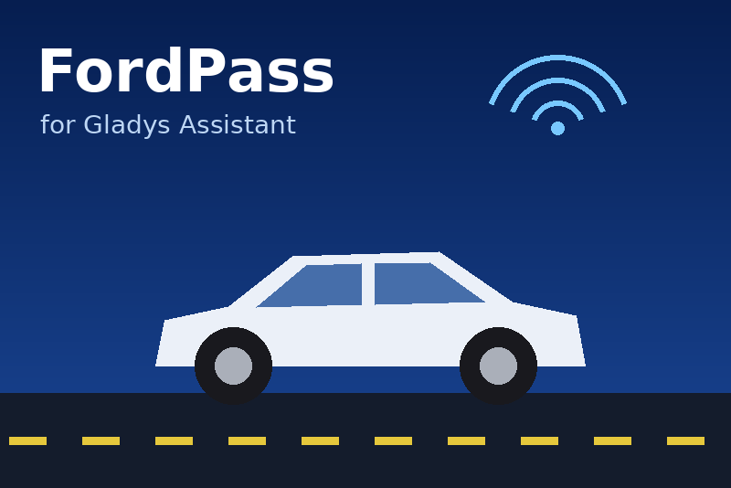

# FordPass for Gladys Assistant

External integration for [Gladys Assistant](https://gladysassistant.com) that
brings your **Ford vehicles** into Gladys through the FordPass connected
services: fuel / battery level, range, odometer, locks, alarm, doors and
windows, tire pressures, GPS position — and the remote commands of the
FordPass app (lock, unlock, remote start, charging).



- **Cloud** integration (manifest `"transports": ["cloud"]`): Ford exposes no
  local API, everything goes through Ford's servers.
- Requires **Gladys 5.1.0 or later** (scene triggers, scene actions and
  dashboard widgets).
- English, French, German and Spanish.

User documentation, re-hosted by Gladys and linked from the Configuration
screen: [English](docs/en.md) · [Français](docs/fr.md) ·
[Deutsch](docs/de.md) · [Español](docs/es.md).

> Ford publishes no public API for its connected cars: this integration uses
> the calls of the FordPass mobile app, as the community integrations of
> other home automation platforms do. Ford can change them at any time. This
> project is not affiliated with nor endorsed by Ford Motor Company.

## Features

| Surface              | What it does                                                                                                     |
| -------------------- | ---------------------------------------------------------------------------------------------------------------- |
| Devices              | One device per vehicle (VIN), with the features of its engine (petrol, diesel, hybrid, plug-in hybrid, electric) |
| Commands             | Lock / unlock, remote start / stop, start / stop charging, from the device features                              |
| Scene triggers       | `low_energy`, `alarm_triggered`, `tire_pressure_warning`, `charge_complete`, `ignition_changed`                  |
| Scene actions        | `vehicle_command` (with its `success` / `status` outputs), `vehicle_status` (last values as outputs)             |
| Dashboard widgets    | `vehicle_overview` (one vehicle, live tiles, status, buttons, map link), `vehicle_fleet` (every vehicle)         |
| Configuration screen | Sign-in (`account_link` + `complete_login`), `test_connection`, `logout`, units, refresh interval, threshold     |

## How the sign-in works

Ford signs users in on its Azure B2C page (authorization code + PKCE) and
redirects to `fordapp://userauthorized/?code=…`, the custom scheme of its
mobile app. That redirect never comes back to Gladys, hence an
`account_link` field: the **Connect** button opens the Ford page built by
`onOAuthAuthorizeUrl`, the user copies the final `fordapp://` address from
the browser developer tools and pastes it into the `complete_login` action.
The code is then exchanged for a Ford token (refreshed for months) and an
Autonomic token (telemetry and commands, ~5 minutes). Tokens are stored with
`gladys.setConfig` under keys outside the `config_schema`.

## Project structure

```
.
├─ index.js                 # SDK wiring: handlers -> runtime
├─ src/
│  ├─ ford/
│  │  ├─ regions.js         # sign-in host, locale, application id per region
│  │  ├─ auth.js            # PKCE, sign-in URL, token exchanges and refresh
│  │  ├─ session.js         # token storage (gladys.setConfig)
│  │  ├─ client.js          # garage, telemetry, commands (+ result polling)
│  │  └─ telemetry.js       # raw telemetry -> normalized snapshot (pure)
│  ├─ vehicle.js            # device blueprint, states, scene events
│  ├─ integration.js        # runtime: vehicles, polling, commands, actions
│  ├─ scenes.js             # scene actions
│  ├─ widgets.js            # dashboard widgets
│  ├─ i18n.js               # every message, in en / fr / de / es
│  ├─ units.js              # km/mi, bar/kPa/psi
│  └─ config.js             # defaults + normalization
├─ docs/{en,fr,de,es}.md    # user documentation
├─ test/                    # node --test, fake Gladys + fake Ford backend
├─ gladys-assistant-integration.json
├─ Dockerfile               # Node 24 Alpine, read-only rootfs ready
├─ CHANGELOG.md · CLAUDE.md · SECURITY.md
└─ .github/                 # CI, multi-arch build, Release workflow, Dependabot
```

## Development

```bash
npm install
npm test               # node --test (no network: Ford is faked)
npm run lint           # ESLint
npm run format:check   # Prettier
npx github:GladysAssistant/integration-store .   # store admission checks
```

Run it against a Gladys instance:

```bash
GLADYS_HOST_API_URL="http://localhost:1443" \
GLADYS_INTEGRATION_TOKEN="<token>" \
GLADYS_INTEGRATION_SELECTOR="fordpass" \
LOG_LEVEL=debug \
npm start
```

## Releasing

Describe the changes under `## [Unreleased]` in [`CHANGELOG.md`](CHANGELOG.md),
then **Actions → Release → Run workflow** (`patch`, `minor` or `major`): the
workflow bumps `package.json` and the manifest, rolls the changelog, tags,
builds the `linux/amd64` + `linux/arm64` image to
`ghcr.io/gboulvin/gladys-fordpass` and publishes the GitHub Release. The GitHub
topic `gladys-assistant-integration` makes the store index it, and the
container package must be **public** so Gladys can pull it.

## Security

See [SECURITY.md](SECURITY.md). Never paste your tokens, your sign-in address
or your VIN in a public issue.

## Credits

The FordPass protocol was documented by the community, in particular the
[ha-fordpass](https://github.com/marq24/ha-fordpass) Home Assistant
integration. Built from the official Gladys
[integration template](https://github.com/GladysAssistant/integration-template-js).

## License

Apache-2.0
